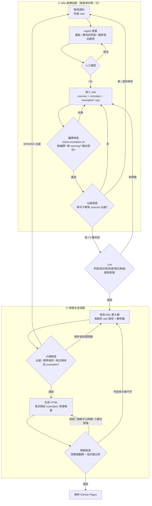

# Loop / Graph 設計

> 上方是**實際跑完後修改的 v2**（流程分支較多，畫成圖反而難讀，所以改用文字和表格說明），下方保留**執行前的 v1** 流程圖對照。修改原因的完整討論在 [reflection.md](reflection.md) 第 3 題，每一項都對應 [run-log.md](run-log.md) 或 [wiki/log.md](../wiki/log.md) 的紀錄。

## 流程（v2，實際跑完後）

整個流程分成兩個迴圈，加上一個貫穿全程的「修正檢查工具」迴圈。每一步寫成「做什麼 → 誰做 → 不通過時回到哪裡」。

### ① Wiki 建構迴圈（每篇資料跑一次，共 6 篇）

| 步驟 | 做什麼 | 誰做 | 不通過時 |
|---|---|---|---|
| 1. 取得資料 | 讀 learncpp，存成 `raw/*.md`（附網址、擷取日期） | LLM 讀取，我確認 | — |
| 2. Ingest 提案 | 列出 3–5 個重點、要改的頁面、要新增的範例 | LLM | — |
| 3. 人工確認 | 確認重點和範例沒有超出範圍 | 我 | 回到 2 |
| 4. 寫入 wiki | 寫 sources、concepts、`examples/*.cpp` | LLM | — |
| 5. **編譯檢查** | `check-examples.sh`：出處註解、15 行以內、示範標記和實際結果相符、輸出 = `.out` | 編譯器 | 回到 4 |
| 6. 頁面一致檢查 | `check-wiki-code.sh`：頁面上的程式碼、輸出、`.err`、`.in` 和檔案一字不差 | 腳本 | 回到 4 |
| 7. 出處自查 | 逐句對照出處，特別檢查「順手補的解釋句」 | LLM 自查 + 我抽查 | 回到 4 |

還有資料 → 回到 1；6 篇都完成 → 進入 Lint。

**Lint**：先跑全部檢查工具，再檢查出處、術語、先教後用、範圍、孤兒頁。wiki 內容有問題 → 回到 4；規則本身有漏洞 → 改 CLAUDE.md（見 ③）。通過 → 進入簡報迴圈。

### ② 簡報生成迴圈

| 步驟 | 做什麼 | 誰做 | 不通過時 |
|---|---|---|---|
| 8. 查詢 wiki 產大綱 | 只用 wiki 內容，每張附 wiki 路徑和範例檔 | LLM | — |
| 9. 大綱檢查 | `[MISSING]`、先教後用、程式碼行數、會不會洩漏小測驗答案（**含程式碼註解**） | LLM 列出問題 | 缺資料 → 回到 1；規則衝突或順序問題 → **我決定**後回到 8 |
| 10. 產生 HTML | `build.mjs` 把模板的佔位符換成 `examples/` 的檔案內容（自動跳脫、上色） | 腳本 | — |
| 11. 程式碼比對 | `check.mjs` 解析產生的 HTML，和 `examples/` 逐字比對；檢查來源標籤 | 腳本（和 build 分開寫） | 回到 10 |
| 12. 截圖檢查 | 桌面／手機、深色／淺色逐張看 | LLM 看截圖 + 我翻閱 | 版面問題 → 改模板或 CSS，回到 10；**程式碼內容要改 → 回到 4**（先改 wiki，簡報才能引用） |

通過 → 發佈到 GitHub Pages。

### ③ 修正檢查工具的迴圈（貫穿全程）
編譯檢查、Lint 或截圖時，如果發現**檢查工具本身**漏抓或誤判，先修工具或規則（`check-*.sh`、`check.mjs`、CLAUDE.md），再故意製造一個錯誤確認工具抓得到，最後重跑原本的檢查。

### v2 和 v1 的差異

| # | 改了什麼 | 為什麼（實際發生的事） | 紀錄 |
|---|---|---|---|
| 1 | 新增「**頁面一致檢查**」節點（`check-wiki-code.sh`），每寫完一頁就跑 | v1 只在最後的簡報檢查比對程式碼。ingest 01 時發現，頁面上貼的程式碼和檔案可能不同，等到簡報才發現就太晚了 | log：ingest 01 |
| 2 | 編譯檢查的內容變多：出處註解、15 行以內、示範標記要和實際結果相符 | v1 只寫了「能編譯？沒有 warning？輸出相符？」。實際跑時：warning 標記沒被驗證、15 行限制沒有工具檢查、無窮迴圈無法驗證 | run-log 編譯檢查表第 16–18 列 |
| 3 | 新增「**修正檢查工具 / 規則**」迴圈（③） | 檢查工具本身出錯了好幾次（PIPESTATUS 讀不到、錨點檢查誤報 11 個、sed 改壞 index）。v1 假設工具一定對，沒有這條路 | log：schema、lint；run-log「連帶問題」 |
| 4 | Lint 可以回到「修改規則」，不只回到「寫入 wiki」 | lint 發現的問題有一半是規則本身的問題：術語表和實際用法衝突、範圍表漏列 `std::boolalpha`、需要新增引用規則 5 | log：lint #3、#5、#7、#8 |
| 5 | 大綱檢查新增「**人工決定**」，並加上「會不會洩漏答案（含程式碼註解）」 | 大綱檢查的 4 個問題都是規則衝突或取捨，AI 不該自己決定。洩漏答案的問題到截圖時才發現 | run-log 大綱檢查 #1–#4、簡報檢查第 1 輪（15、16 張） |
| 6 | 「生成 HTML」拆成 **build.mjs 產生 → check.mjs 比對 → 截圖檢查** | 程式碼由腳本讀檔放進 HTML，不靠 LLM 貼上；比對工具和產生工具分開，才不會自己檢查自己 | run-log「生成 HTML」 |
| 7 | 簡報檢查「內容要改」改成回到**寫入 wiki**，不是回到大綱 | 小測驗洩漏答案時，簡報上的程式碼不能刪註解（要一字不差），只能先在 wiki 新增範例 53、37，再讓簡報引用 | run-log 簡報檢查第 1 輪 |
| 8 | 「只重生該張投影片」拿掉 | 整份由腳本產生，重新產生全部只要一秒，比只改一張更不容易出錯 | run-log「生成 HTML」 |
| 9 | 「5 篇完成」改成「6 篇」 | 依實際情況更新 | log：raw |

### Q1–Q3 的補充（v2）
- **重複執行的地方多了一個**：「檢查工具 → 修正工具 → 重跑」。每次強化工具後，都先故意製造錯誤，確認工具抓得到（例如故意改壞一個字、把 `&lt;` 換回 `<`），再拿去檢查 wiki。
- **檢查點多了兩個**：頁面一致檢查（每頁寫完就跑），以及簡報的 `check.mjs`（獨立於產生工具）。
- **設計理由多了一條**：檢查工具也會出錯。看到大量錯誤時先懷疑工具；看到全部通過時，也要先確認工具真的會抓錯。

---

## 流程圖（v1，執行前的設計）

## 節點說明（v1）

| 節點 | 輸入 | 輸出 | 誰做 |
|---|---|---|---|
| 取得資料 | 網址 | `raw/*.md`（含網址、日期） | 我 |
| Ingest 提案 | 一篇 raw | 3–5 重點 + 要改的頁面 + 要新增的範例 | LLM |
| 人工確認 | 提案 | OK / 修改意見 | 我 |
| 寫入 wiki | 確認後的提案 | sources、concepts、`examples/*.cpp`、index、log | LLM |
| **編譯檢查** | `examples/*.cpp` | ✅/❌ 清單、`.out` 檔 | `check-examples.sh`（編譯器） |
| 出處檢查 | 新寫入的句子 | 通過 / 退回 | LLM 自查 + 我抽查 |
| Lint | 整個 wiki + examples | 問題清單 | LLM + 再跑一次編譯檢查 |
| 查詢 Wiki 產大綱 | wiki + 簡報需求 | 每張投影片：標題、重點、wiki 路徑、範例檔 | LLM |
| 大綱檢查 | 大綱 | 通過 / 退回到「查詢」或「取得資料」 | 我 + LLM |
| 生成 HTML | 大綱 + examples | `slides/index.html` | LLM |
| 簡報檢查 | HTML | 通過 / 指定要重生的投影片 | 我（瀏覽器）+ LLM（比對程式碼） |

## Q1：哪些步驟會重複執行？
1. **Ingest 迴圈**：「取得資料 → 提案 → 確認 → 寫入 → 編譯檢查 → 出處檢查」對每篇資料各跑一次（至少 5 次）。一次一篇，新資料才能和既有內容比對，例如不同來源推薦的初始化寫法不同，就會在這時被發現。
2. **編譯修正迴圈**：「寫入 → 編譯檢查」重複到所有範例都能編譯、沒有 warning、輸出和 `.out` 一致。
3. **大綱迴圈**：「查詢 Wiki → 大綱檢查」重複到每個重點都有出處、沒有先用後教的語法（例如還沒教 `++` 就在 `for` 裡用 `i++`）。
4. **HTML 迴圈**：「生成 → 簡報檢查」重複到版面與程式碼都正確；只重生出問題的那幾張。

## Q2：哪些地方需要檢查或重新生成？
| 檢查點 | 檢查什麼 | 失敗時回到 |
|---|---|---|
| 人工確認 | 重點是否抓對、範例是否超出範圍 | Ingest 提案 |
| 編譯檢查 | 能編譯、無 warning、實際輸出 = `.out` | 寫入 wiki（修程式或修說明） |
| 出處檢查 | 新增句子是否都能對到 sources/ | 寫入 wiki |
| Lint | 矛盾、孤兒頁、術語、程式風格、範例檔對應 | 寫入 wiki |
| 大綱檢查 | `[MISSING]`、先教後用、程式碼是否都來自 `examples/` | 缺資料→取得資料；其他→查詢 Wiki |
| 簡報檢查 | 翻頁、程式碼溢出、`<iostream>` 等跳脫字元、程式碼與 `examples/` 一字不差、來源標籤 | 生成 HTML（單張）或查詢 Wiki |

## Q3：為什麼這樣設計？
- **用編譯器當客觀檢查者**：LLM 檢查自己寫的東西，常會「自己說服自己」；但編譯器和實際執行結果不會。所以程式正確性交給 `check-examples.sh`，不靠 LLM 自評。`.out` 檔一律由實際執行產生，LLM 不能自己寫「預期輸出」。
- **越早檢查越便宜**：範例在 ingest 時就編譯驗證，錯了只要改一個 `.cpp`；等到簡報做完才發現，wiki、大綱、HTML 都要一起改。
- **單一事實來源**：程式碼只存在 `examples/`，wiki 和簡報都從這裡引用，維持「簡報 ⊆ wiki ⊆ raw」，且三處的程式碼永遠一致。
- **缺資料就回到源頭**：LLM 很懂 C++，最容易用自己的知識偷偷補內容。大綱發現 wiki 沒講的東西時，回去 ingest 新資料，而不是讓 LLM 補寫。
- **人只放在高槓桿的點**：人工確認 ingest 提案與翻閱 HTML，其餘交給編譯器和 CLAUDE.md 規則自查。
